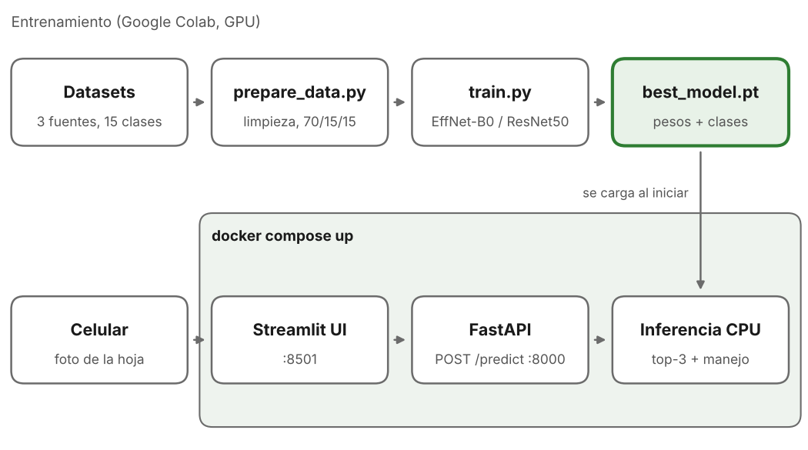

# FitoDiag-PY 🌱

Diagnóstico temprano de enfermedades foliares en **soja, mandioca y sésamo** a partir de una foto tomada con el celular.

Proyecto final de Palmira Benítez y Sebastián Villalba. El sistema es end-to-end: dataset → modelo → API REST → interfaz web → Docker.



## Qué hace

El agricultor saca una foto de una hoja. El sistema devuelve:

- la enfermedad detectada (15 clases en 3 cultivos);
- la probabilidad y las otras dos opciones más probables;
- una sugerencia de manejo;
- un aviso de "no estoy seguro" cuando la confianza es menor al 50%;
- **filtro por cultivo** (opcional): si el agricultor indica que es soja, mandioca o sésamo, el modelo solo considera las enfermedades de ese cultivo, y avisa si la foto no parece de ese cultivo;
- **mapa de calor Grad-CAM**: muestra en rojo las zonas de la hoja que más pesaron en el diagnóstico;
- **historial** de los diagnósticos de la sesión, con resumen y descarga en CSV.

## Levantar todo con un solo comando

Requisitos: Docker Desktop (o Docker Engine + Compose v2) y el archivo `models/best_model.pt`.

```bash
docker compose up --build
```

| Servicio | URL |
| --- | --- |
| Interfaz (Streamlit) | http://localhost:8501 |
| API (Swagger) | http://localhost:8000/docs |

¿Todavía no hay modelo entrenado? Generen uno de prueba (pesos aleatorios, solo para verificar que todo funciona):

```bash
pip install torch torchvision timm
python scripts/make_dummy_model.py --out models/best_model.pt
```

### Usarlo desde el celular

1. Celular y laptop en la misma red wifi.
2. En el celular, abrir `http://<IP-de-la-laptop>:8501`.
3. Usar la pestaña **Subir foto**: en Android y iPhone ofrece sacar la foto con la cámara.

La pestaña **Cámara** del navegador necesita HTTPS cuando no es `localhost`. Para la demo con el celular, se puede abrir un túnel HTTPS gratis con `cloudflared tunnel --url http://localhost:8501`.

## Estructura

```
fitodiag-py/
├── api/                  API REST (FastAPI) + treatments.json
├── ui/                   Interfaz (Streamlit)
├── src/fitodiag/         Código compartido: clases, modelo, transformaciones
├── scripts/              Pipeline: descarga, preparación, entrenamiento, evaluación
├── notebooks/            Notebook para entrenar en Google Colab
├── data/README.md        Datasheet del dataset
├── models/               best_model.pt (Git LFS)
├── paper/                Informe IEEE en LaTeX
├── docker/               Dockerfiles de api y ui
├── tests/                Pruebas (pytest)
└── docker-compose.yml
```

## Pipeline completo (reproducir los resultados)

El entrenamiento se hace en Google Colab con GPU: `notebooks/entrenamiento_colab.ipynb` corre todos estos pasos.

```bash
pip install -r requirements/dev.txt

# 1. Datos (ver data/README.md)
bash scripts/download_data.sh
python scripts/prepare_data.py

# 2. Entrenamiento: dos arquitecturas + ablación sin técnicas contra el desbalance
python scripts/train.py --arch efficientnet_b0
python scripts/train.py --arch resnet50
python scripts/train.py --arch efficientnet_b0 --run-name effnet_baseline --no-augment --no-balance

# 3. Evaluación en test + tablas y figuras para el informe
for r in efficientnet_b0 resnet50 effnet_baseline; do python scripts/evaluate.py --run models/$r; done
python scripts/compare_runs.py --runs models/efficientnet_b0 models/resnet50 models/effnet_baseline \
    --best models/efficientnet_b0

# 4. Copiar el modelo elegido para la API
cp models/efficientnet_b0/best_model.pt models/best_model.pt
```

También hay atajos en el `Makefile` (`make prepare`, `make train-effnet`, `make up`, etc.).

## Modelo

| Aspecto | Elección |
| --- | --- |
| Arquitecturas | EfficientNet-B0 (4,0 M parámetros) y ResNet50 (23,5 M), preentrenadas en ImageNet (timm) |
| Fine-tuning | 2 épocas solo la cabeza + hasta 15 épocas todo el modelo; AdamW, cosine annealing |
| Desbalance | Data augmentation para fotos de campo + WeightedRandomSampler + label smoothing 0,1 |
| Selección | Early stopping sobre F1 macro de validación (paciencia 5) |
| Métricas | Accuracy, F1 macro y ponderado, top-3, accuracy por cultivo, tasa de cultivo equivocado, matriz de confusión, latencia en CPU |

## Resultados

Conjunto de prueba: 2.009 imágenes que el modelo nunca vio durante el entrenamiento (detalle en `results.md` y en el informe, `paper/main.pdf`).

| Modelo | Params (M) | Acc. (%) | F1 macro (%) | Top-3 (%) | CPU (ms) | Tamaño |
| --- | ---: | ---: | ---: | ---: | ---: | ---: |
| **EfficientNet-B0** (el de la API) | 4,0 | 81,5 | 80,4 | 97,2 | 53 | 16 MB |
| ResNet50 | 23,5 | 81,5 | 81,1 | 97,3 | 132 | 94 MB |
| EfficientNet-B0 sin aumento ni balanceo | 4,0 | 80,4 | 78,7 | 94,8 | 58 | 16 MB |

- EfficientNet-B0 y ResNet50 rinden igual, pero EfficientNet-B0 es 2,5 veces más rápido en CPU y 6 veces más chico: por eso es el modelo de la API.
- El aumento de datos y el muestreo ponderado suben el F1 macro 1,7 puntos y el *recall* macro de 78,0 a 80,9 %: sin ellos, el modelo deja de reconocer las clases chicas.
- Exactitud por cultivo (EfficientNet-B0): sésamo 97,0 %, mandioca 77,1 %, soja 72,8 %. El modelo se equivoca de cultivo en 1 de 2.009 imágenes.

### Prueba del sistema completo (45 fotos)

Además del conjunto de prueba, se probó el sistema de punta a punta a través de la API: 45 fotos de campo, 3 por clase, enviadas una vez sin filtro y otra con el cultivo correcto y Grad-CAM.

```bash
python scripts/probar_carpeta.py --fotos ruta/a/imagenes_prueba --out pruebas
```

| Métrica | Resultado |
| --- | --- |
| Accuracy | 36/45 (80 %) |
| Clase correcta dentro del top-3 | 42/45 (93 %) |
| Cultivo correcto | 45/45 (100 %) |
| Accuracy con filtro por cultivo | 36/45 (80 %) |
| Respuestas con "no estoy seguro" | 7 sin filtro, 5 con filtro |
| Errores marcados como "no estoy seguro" | 4 de 9 |

| Clase | Aciertos | Clase | Aciertos |
| --- | :---: | --- | :---: |
| Mandioca: bacteriosis | 1/3 | Sésamo: amarillamiento | 3/3 |
| Mandioca: estría marrón | 3/3 | Sésamo: insectos | 3/3 |
| Mandioca: mosaico | 3/3 | Sésamo: mancha foliar | 3/3 |
| Mandioca: moteado verde | 1/3 | Sésamo: sana | 3/3 |
| Mandioca: sana | 3/3 | Soja: mancha marrón | 0/3 |
| Soja: mosaico | 3/3 | Soja: ojo de rana | 2/3 |
| Soja: oruga | 2/3 | Soja: roya | 3/3 |
| Soja: sana | 3/3 | | |

Observaciones:

- La accuracy (80 %) coincide con la del conjunto de prueba (81,5 %).
- Todos los errores fueron **entre enfermedades del mismo cultivo**. Por eso el filtro por cultivo no cambió el resultado en estas fotos; su utilidad es evitar confusiones de cultivo con fotos más variadas.
- La clase más difícil es la **mancha marrón de la soja** (0/3): se confunde con roya y ojo de rana, que también tienen lesiones chicas y oscuras. Es también la de menor F1 en el conjunto de prueba.
- En los errores, Grad-CAM muestra que el modelo mira las lesiones de la hoja y no el fondo: falla porque los síntomas se parecen.
- Las fotos provienen del conjunto de prueba, que el modelo no vio durante el entrenamiento; no reemplazan una validación con fotos tomadas en Paraguay.

## API

| Método | Ruta | Descripción |
| --- | --- | --- |
| GET | `/health` | Estado del servicio y del modelo |
| GET | `/classes` | Las 15 clases con síntomas y sugerencia |
| POST | `/predict` | Imagen (multipart, campo `file`) → diagnóstico |

Parámetros opcionales de `/predict` (query string):

| Parámetro | Valores | Efecto |
| --- | --- | --- |
| `cultivo` | `soja`, `mandioca`, `sesamo` | Solo considera las clases de ese cultivo (las probabilidades se renormalizan dentro del cultivo). Si menos del 50% de la probabilidad original correspondía a ese cultivo, `aviso_cultivo` lo advierte. |
| `explicar` | `true` / `false` | Agrega `gradcam_png`: el mapa Grad-CAM superpuesto a la foto, PNG en base64. Suma ~100 ms en CPU. |

```bash
curl -F "file=@hoja.jpg" http://localhost:8000/predict
curl -F "file=@hoja.jpg" "http://localhost:8000/predict?cultivo=soja&explicar=true"
```

Variables de entorno: `MODEL_PATH`, `CONFIDENCE_THRESHOLD` (0,5), `MAX_UPLOAD_MB` (10), `TORCH_THREADS` (2).

## Pruebas

```bash
pytest -q
```

Las pruebas crean un modelo de pesos aleatorios: no hace falta entrenar para correrlas.

## Flujo de trabajo en git

- Ramas: `main` (estable, lo que se presenta), `dev` (integración), `feat/<historia>`.
- Cada historia de usuario es un issue (plantilla en `.github/ISSUE_TEMPLATE`). Los commits la referencian: `feat(api): endpoint predict (#5)`.
- Prefijos: `feat`, `fix`, `docs`, `test`, `exp` (experimentos de entrenamiento), `chore`.
- El modelo se versiona con Git LFS: `git lfs install && git lfs track "*.pt"` (ya está en `.gitattributes`).

## Limitaciones

Ninguna imagen del dataset es de Paraguay. El modelo no se validó con fotos locales y puede rendir menos en el campo. Las sugerencias de manejo son orientativas y no reemplazan a un ingeniero agrónomo ni las recomendaciones del SENAVE. Ver `data/README.md`.

## Autores

Palmira Benítez · Sebastián Villalba
